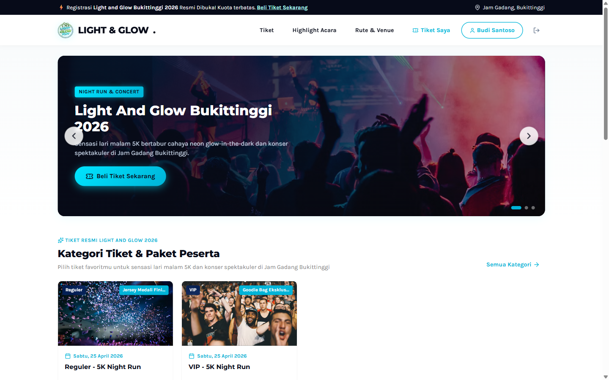

# Light & Glow Bukittinggi 2026 🏃‍♂️✨

Platform pemesanan tiket resmi, pembayaran QRIS dinamis, manajemen kuota, dan sistem verifikasi check-in berbasis QR Scanner untuk event **Light & Glow Night Run Bukittinggi 2026**.

---

## 📸 Tampilan Halaman Utama (Landing Page)



---

## 🚀 Fitur Utama

- **Pemesanan Tiket & QRIS Dinamis:** Pemilihan kategori tiket, pembuatan kode QRIS otomatis, dan upload bukti bayar.
- **Dashboard Pembeli:** Manajemen tiket digital, riwayat transaksi, dan akses kode QR tiket resmi.
- **Portal Admin (Adminator):** Verifikasi pembayaran, manajemen tiket & benefit, monitoring pesanan, dan rekap data pengguna.
- **Scanner Petugas Gate:** Validasi tiket QR Code secara real-time dengan proteksi ganda (*anti-duplikasi/tiket bekas pakai*).

---

## 🛠️ Persyaratan Sistem

- PHP >= 8.2 (Ekstensi: `pdo_mysql`, `mysqli`, `pdo_sqlite`, `openssl`, `curl`, `fileinfo`, `gd`)
- MySQL / MariaDB
- Composer
- Node.js & NPM

---

## ⚙️ Panduan Instalasi

1. **Clone repository ini:**
   ```bash
   git clone https://github.com/RimuruTempestCkCK/lightandglowrunbkt.git
   cd lightandglowrunbkt
   ```

2. **Instal dependensi:**
   ```bash
   composer install
   npm install
   ```

3. **Konfigurasi Environment:**
   Salin `.env.example` menjadi `.env`, lalu sesuaikan konfigurasi database Anda:
   ```bash
   cp .env.example .env
   php artisan key:generate
   ```

4. **Jalankan Migrasi & Database Seeder:**
   ```bash
   php artisan migrate --seed
   ```

5. **Hubungkan Symlink Storage:**
   ```bash
   php artisan storage:link
   ```

6. **Jalankan Aplikasi:**
   ```bash
   php artisan serve
   ```
   Buka browser di `http://127.0.0.1:8000`.

---

## 🧪 Menjalankan Pengujian

```bash
php artisan test
```

---

## 📄 Lisensi
Hak cipta © 2026 **Light and Glow Bukittinggi**. Didistribusikan di bawah lisensi [MIT](LICENSE).
