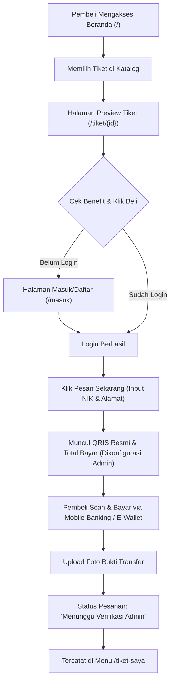
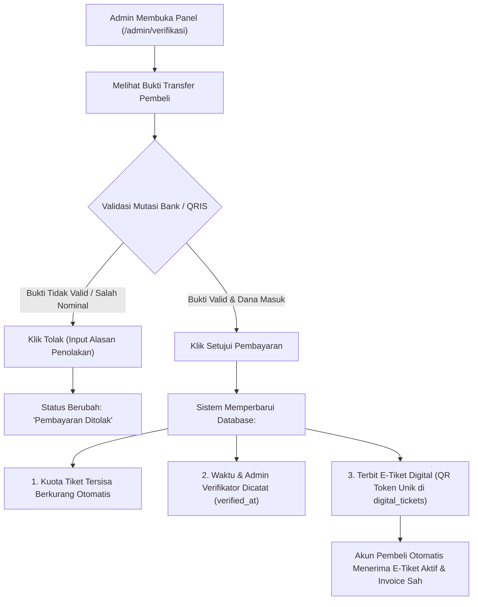

# Dokumentasi Sistem Web Light and Glow Bukittinggi 2026

Dokumen ini memuat dokumentasi arsitektur sistem, peran pengguna (aktor), skema database MySQL, modul yang telah terintegrasi, struktur kode, serta diagram alur proses (*business workflow*) pada aplikasi web resmi **Light and Glow Bukittinggi 2026**.

---

## 1. Aktor di dalam Web (User Roles & Permissions)

Sistem membagi aksesibilitas pengguna ke dalam **3 Aktor Utama**:

| No | Aktor | Akses & URL | Hak Akses & Tugas |
|:---|:---|:---|:---|
| 1 | **Pembeli / Peserta (*Buyer / Runner*)** | Area Publik & Dashboard Pembeli (`/`, `/tiket/{id}`, `/masuk`, `/daftar`, `/tiket-saya`) | - Mengakses katalog event & kuota tiket tersisa.<br>- Melihat halaman khusus preview detail & list benefit resmi tiket.<br>- Melakukan pendaftaran/login akun pembeli.<br>- Memesan tiket dengan mengisi identitas (Nama, Email, WhatsApp, NIK, Alamat).<br>- Melakukan pembayaran QRIS (gambar QRIS barcode resmi & NMID merchant dinamis dari database) & mengunggah bukti transfer.<br>- Melihat status verifikasi pembayaran real-time.<br>- Membuka & mencetak **Invoice Resmi** (PDF 1 halaman).<br>- Membuka & mencetak **E-Tiket Digital (QR Code E-Pass)** (PDF 1 halaman). |
| 2 | **Administrator Panitia (*Admin*)** | Panel Adminator (`/admin/dashboard`, `/login`) | - Memantau ringkasan statistik pendapatan (*revenue*), pesanan masuk, dan ketersediaan kuota tiket real-time (hanya ada kartu KPI di dashboard).<br>- **Master Acara & QRIS Pembayaran (`/admin/acara`)**: Mengelola gambar barcode QRIS resmi toko/panitia, nama merchant, NMID, lokasi, dan jadwal event yang langsung terhubung ke modal pembayaran pembeli.<br>- **Master Tiket & Benefit (`/admin/tiket`)**: Menambah, mengedit kuota/harga/daftar benefit pamflet, dan menghapus tiket di database MySQL.<br>- **Master Rute & Spot Ikonik (`/admin/rute`)**: Mengelola foto, nama spot, dan deskripsi rute lari 5K Bukittinggi.<br>- **Master Banner Hero (`/admin/banner`)**: Mengelola materi promosi carousel landing page.<br>- **Verifikasi Pembayaran (`/admin/verifikasi`)**: Memvalidasi bukti transfer QRIS pembeli (*Setujui* atau *Tolak*). Begitu disetujui, QR Code e-tiket terbit otomatis di akun pembeli.<br>- **Data Pesanan & Laporan (`/admin/pesanan`, `/admin/kehadiran`, `/admin/petugas`)**: Memantau seluruh transaksi, log gate, dan data petugas. |
| 3 | **Petugas Scanner Gerbang (*Gate Scanner / Officer*)** | Panel Gate Scanner (`/petugas/dashboard`) | - Membuka kamera pemindai QR Code di gerbang masuk (*Gate Entry*).<br>- Memvalidasi keaslian QR Code E-Pass peserta secara real-time via REST API.<br>- Sistem otomatis mendeteksi tiket valid (pertama kali scan) vs tiket kedaluwarsa/tiket palsu (*Double Check-in Protection*).<br>- Mencatat waktu dan gerbang check-in ke tabel log database. |

---

## 2. Tabel Database MySQL & Relasi Data

Aplikasi terhubung langsung dengan database MySQL local (`lightandglowrunbkt`) menggunakan konfigurasi `.env`.

### Daftar Tabel Inti

```
+--------------------------------------------------------------------------+
|                        SKEMA DATABASE UTAMA                              |
+--------------------------------------------------------------------------+
|  1. events           : Profil acara, foto QRIS pembayaran & merchant     |
|  2. ticket_types     : Kategori tiket, harga, kuota, & benefit pamflet   |
|  3. event_spots      : Spot ikonik & foto rute/venue Bukittinggi         |
|  4. buyers           : Akun & data identitas pembeli/peserta             |
|  5. orders           : Transaksi pemesanan, bukti bayar, & verifikasi    |
|  6. digital_tickets  : E-Tiket ber-QR token unik (1 token per tiket)     |
|  7. check_in_logs    : Riwayat pemindaian scanner di gate masuk          |
|  8. users            : Akun login Administrator & Petugas Panitia        |
|  9. banners          : Banner promosi carousel                           |
+--------------------------------------------------------------------------+
```

### Rincian Struktur Kolom & Tipe Data

#### `events` (Data Event & QRIS Pembayaran Resmi)
- `id` (BIGINT PK, Auto Increment)
- `title` (VARCHAR 255): Judul acara
- `slug` (VARCHAR 255, Unique)
- `description` (TEXT): Deskripsi acara
- `location` (VARCHAR 255): Lokasi venue (*Jam Gadang, Bukittinggi*)
- `event_date` (DATE): Tanggal pelaksanaan
- `start_time`, `end_time` (TIME)
- `banner_image` (VARCHAR 255): Banner sampul
- `qris_image` (VARCHAR 255, Nullable): URL / path gambar Barcode QRIS pembayaran yang dapat diedit oleh admin
- `qris_merchant_name` (VARCHAR 100): Nama akun merchant QRIS (*LIGHT AND GLOW BUKITTINGGI*)
- `qris_nmid` (VARCHAR 50, Nullable): Nomor Identifikasi QRIS Nasional (NMID)
- `status` (VARCHAR 50): Status event
- `created_at`, `updated_at` (TIMESTAMP)

#### `ticket_types` (Katalog Tiket & Paket Peserta)
- `id` (BIGINT PK, Auto Increment)
- `event_id` (BIGINT, FK ke `events`)
- `name` (VARCHAR 150): Nama tiket (misal: *Reguler - 5K Night Run*, *VIP - 5K Night Run*)
- `category` (VARCHAR 50): Tipe/kategori (Reguler, VIP)
- `price` (DECIMAL 12,2): Harga tiket (Rp 100.000, Rp 200.000)
- `quota` (INT): Total kuota tiket
- `remaining_quota` (INT): Sisa kuota tiket (otomatis berkurang saat disetujui)
- `benefits` (TEXT): Daftar benefit pamflet per baris (*Jersey, Medali Finisher, Stick Glow, E-Sertifikat, dll*)
- `image` (TEXT): URL foto tiket
- `is_active` (BOOLEAN): Status aktif tampil di web
- `created_at`, `updated_at` (TIMESTAMP)

#### `event_spots` (Spot Ikonik Rute & Venue Bukittinggi)
- `id` (BIGINT PK, Auto Increment)
- `name` (VARCHAR 100): Nama spot ikonik (*Jam Gadang*, *Ngarai Sianok*, dll)
- `description` (VARCHAR 255): Peran rute (*Start & Finish / Main Stage*, dll)
- `image` (TEXT): URL / Path foto lokasi
- `order_index` (INT): Urutan prioritas tampil di landing page
- `is_active` (BOOLEAN): Status aktif
- `created_at`, `updated_at` (TIMESTAMP)

#### `buyers` (Akun Pembeli)
- `id` (BIGINT PK, Auto Increment)
- `name` (VARCHAR 150): Nama lengkap pemesan
- `email` (VARCHAR 150, Unique): Alamat email aktif
- `password` (VARCHAR 255): Password terenkripsi `Hash::make()`
- `phone` (VARCHAR 30): Nomor WhatsApp / Telepon
- `nik` (VARCHAR 30): Nomor Induk Kependudukan (untuk registrasi lari)
- `address` (TEXT): Alamat domisili
- `created_at`, `updated_at` (TIMESTAMP)

#### `orders` (Transaksi Pemesanan Tiket)
- `id` (BIGINT PK, Auto Increment)
- `order_number` (VARCHAR 50, Unique): Kode pesanan resmi (misal: `LG-88421`)
- `buyer_id` (BIGINT, FK ke `buyers`)
- `ticket_type_id` (BIGINT, FK ke `ticket_types`)
- `quantity` (INT): Jumlah tiket yang dibeli
- `total_amount` (DECIMAL 12,2): Total tagihan pembayaran
- `payment_method` (VARCHAR 50): Metode bayar (`QRIS`)
- `qris_payload` (TEXT): Payload QRIS statis / dinamis
- `payment_proof` (TEXT): Path bukti transfer yang diunggah pembeli
- `proof_uploaded_at` (TIMESTAMP): Waktu upload bukti transfer
- `status` (ENUM): `Menunggu verifikasi`, `Pembayaran disetujui`, `Pembayaran ditolak`
- `rejection_reason` (TEXT): Alasan penolakan jika tidak valid
- `verified_at` (TIMESTAMP): Waktu verifikasi oleh admin
- `verified_by` (BIGINT, FK ke `users`): Admin yang memverifikasi
- `created_at`, `updated_at` (TIMESTAMP)

#### `digital_tickets` (E-Pass Masuk Ber-QR Code)
- `id` (BIGINT PK, Auto Increment)
- `order_id` (BIGINT, FK ke `orders`)
- `ticket_type_id` (BIGINT, FK ke `ticket_types`)
- `ticket_code` (VARCHAR 50, Unique): Kode seri tiket (misal: `TKT-LG-88421-1`)
- `qr_token` (VARCHAR 255, Unique): Token unik terenkripsi untuk scanner
- `holder_name` (VARCHAR 150): Nama pemegang tiket
- `gate` (VARCHAR 100): Akses gerbang masuk (*Gate 1 Utama Jam Gadang*)
- `status` (ENUM): `Belum digunakan`, `Sudah digunakan`
- `used_at` (TIMESTAMP): Waktu saat di-scan di gerbang
- `created_at`, `updated_at` (TIMESTAMP)

#### `check_in_logs` (Log Scan Gerbang Masuk)
- `id` (BIGINT PK, Auto Increment)
- `digital_ticket_id` (BIGINT, FK ke `digital_tickets`)
- `scanned_by` (BIGINT, FK ke `users`)
- `gate_name` (VARCHAR 100)
- `scan_timestamp` (TIMESTAMP)
- `validation_status` (VARCHAR 50): `success`, `already_used`, `invalid`

---

## 3. Fitur yang Telah Terintegrasi ke Web

1. **Kelola & Upload Gambar QRIS Pembayaran Tiket oleh Admin (`/admin/acara`)**:
   - Admin dapat **mengunggah file foto/gambar Barcode QRIS resmi** (PNG, JPG, WEBP) atau memasukkan path/URL gambar, nama akun merchant, dan nomor NMID secara mandiri.
   - File gambar QRIS tersimpan di server (`public/uploads/qris/`) dan path tersimpan di tabel `events` MySQL.
   - Gambar QRIS ini langsung otomatis tampil pada modal checkout pembelian tiket pembeli untuk di-scan secara nyata melalui aplikasi m-Banking atau E-Wallet.
2. **Halaman Khusus Preview Tiket & Benefit Peserta (`/tiket/{id}`)**:
   - Membuka halaman preview penuh (bukan popup) yang menyajikan detail paket, foto sampul, dan checklist benefit resmi sesuai pamflet (*Jersey, Medali Finisher, Stick Glow, E-Sertifikat, dll*).
   - Terhubung langsung dengan tombol beli pada Landing Page.
3. **Pembersihan Navigasi Admin & Role Segregation**:
   - Tautan *"Lihat di Web"* telah dihapus dari seluruh halaman admin (`/admin/tiket`, `/admin/rute`).
   - Kartu metrik KPI hanya ada secara eksklusif pada **Dashboard Admin** (`/admin/dashboard`). Halaman admin lainnya murni berupa tabel master data dan form input.
   - File template tidak terpakai seperti `admin/scanner.blade.php` dan `admin/cms.blade.php` telah dibersihkan.
   - Sidebar Admin dan Petugas Scanner dipisahkan secara ketat sehingga admin tidak melihat menu scanner petugas di sidebar.
4. **Integrasi Kuota Real-time**:
   - Menampilkan sisa kuota tiket di landing page dan halaman detail.
   - Bila kuota tersisa = 0, tombol otomatis berubah menjadi disabled bertuliskan *"Tiket Habis"*.
5. **Pemesanan & Checkout QRIS**:
   - Form pemesanan tiket dengan identitas pembeli.
   - Menghasilkan gambar barcode QRIS resmi yang diatur admin.
   - Fitur upload foto screenshot/bukti pembayaran langsung ke server.
6. **Verifikasi Admin Real-time Database (`/admin/verifikasi`)**:
   - Menu verifikasi admin untuk memvalidasi bukti transfer.
   - Tombol *Setujui* otomatis memotong kuota dan menerbitkan record `digital_tickets` dengan token QR unik.
7. **Dashboard Pembeli (`/tiket-saya`)**:
   - **Tab Riwayat Transaksi**: Menampilkan daftar order dan status verifikasi.
   - **Fitur Lihat & Cetak Invoice Resmi (PDF 1 Halaman)**:
     - Dilengkapi logo resmi web (`logo-lightandrun.png`).
     - Menyajikan data lengkap pemesan (Nama, Email, HP, NIK, Alamat).
     - Menampilkan tanggal & jam verifikasi admin (`verified_at`) dan nama admin verifikator.
   - **Tab Tiket Digital Aktif (E-Pass)**:
     - Menampilkan QR Code resmi untuk di-scan.
     - **Fitur Cetak QR E-Pass (PDF 1 Halaman)** dengan banner header eksklusif.
     - Efek visual *EXPIRED* dengan silang merah bila tiket sudah di-check-in di gerbang.
8. **Kelola Rute & Venue Spot Ikonik (`/admin/rute`)**:
   - Admin dapat menambah, mengedit foto (dengan live preview), mengubah deskripsi, dan mengatur urutan spot ikonik Bukittinggi (*Jam Gadang, Ngarai Sianok, Fort de Kock, Jembatan Limpapeh, Pasar Atas*).
   - Data otomatis tersinkronisasi ke landing page pembeli.
9. **Scanner Petugas Gerbang (`/petugas/dashboard`)**:
   - Scanner kamera HTML5/JS untuk membaca QR token pembeli.
   - Proteksi tiket ganda (*One-time Scan Protection*).

---

## 4. Struktur Kode Proyek

Struktur direktori utama berbasis arsitektur **Laravel 11**:

```
lightandglowrunbkt/
├── .git/                                # Repositori Git (Remote origin/main)
├── logo-lightandrun-removebg-preview.png # Aset Logo Master
├── WhatsApp Image 2026-10-16...jpeg     # Pamflet Acara & Benefit Resmi
├── SISTEM_LIGHTANDGLOW.md               # Dokumentasi Lengkap Arsitektur Sistem
├── laravel-app/
│   ├── app/
│   │   ├── Http/
│   │   │   └── Controllers/
│   │   │       ├── BuyerAuthController.php   # Login, Register, Logout Pembeli
│   │   │       ├── OrderController.php       # Checkout, QRIS, Upload Bukti, Scanner API
│   │   │       └── Controller.php            # Base Controller
│   │   └── Models/
│   │       └── User.php                      # Model User Admin
│   ├── database/
│   │   └── migrations/
│   │       ├── ..._create_events_table.php
│   │       ├── ..._create_ticket_types_table.php
│   │       ├── ..._create_buyers_table.php
│   │       ├── ..._create_orders_table.php
│   │       ├── ..._create_digital_tickets_table.php
│   │       ├── ..._create_check_in_logs_table.php
│   │       ├── ..._create_event_spots_table.php        # Spot Rute & Foto Ikonik
│   │       └── ..._add_qris_columns_to_events_table.php # Konfigurasi QRIS Image & Merchant
│   ├── public/
│   │   ├── adminator/                        # Bundle Aset Adminator Template
│   │   │   ├── 2026.5a84696f.js              # Navigasi & Shell Admin Sidebar
│   │   │   └── style.76ee5eee.css            # Stylesheet Adminator
│   │   ├── logo-lightandrun.png              # Logo Resmi Light & Glow
│   │   ├── poster-lightandglowrun.jpeg       # Poster Banner Hero
│   │   ├── style.css                         # Custom Design System, Responsive & Print CSS
│   │   └── script.js                         # Logika DOM Frontend & Filter
│   ├── resources/
│   │   └── views/
│   │       ├── welcome.blade.php             # Halaman Utama (Landing Page Pembeli)
│   │       ├── admin/
│   │       │   ├── dashboard.blade.php       # Dashboard Statistik Utama Admin (KPI Cards)
│   │       │   ├── tiket.blade.php           # Master Tiket, Harga, Kuota & Benefit Pamflet
│   │       │   ├── rute.blade.php            # Master Rute & Spot Ikonik Bukittinggi
│   │       │   ├── verifikasi.blade.php      # Verifikasi Bukti Pembayaran QRIS
│   │       │   ├── pesanan.blade.php         # Tabel Seluruh Riwayat Pesanan
│   │       │   ├── banner.blade.php          # Kelola Banner Promo
│   │       │   ├── acara.blade.php           # Master Acara & Edit QRIS Pembayaran
│   │       │   ├── kehadiran.blade.php       # Log Audit Check-in Venue
│   │       │   └── petugas.blade.php         # Akun Petugas Gate Scanner
│   │       ├── buyer/
│   │       │   ├── login.blade.php           # Login Khusus Pembeli
│   │       │   ├── register.blade.php        # Registrasi Akun Pembeli
│   │       │   ├── ticket-detail.blade.php   # Preview Halaman Tiket & Modal Checkout QRIS
│   │       │   └── dashboard.blade.php       # Dashboard E-Tiket & Cetak Invoice 1 Halaman
│   │       └── petugas/
│   │           └── dashboard.blade.php       # Antarmuka Scanner Kamera QR Petugas
│   ├── routes/
│   │   └── web.php                           # Definisi Seluruh Rute Web & Endpoint API
│   └── .env                                  # Konfigurasi Environment & DB MySQL
```

---

## 5. Alur Sistem Web (*Workflow & Business Process*)

### 5.1 Alur Pemesanan & Pembelian Tiket oleh Pembeli



---

### 5.2 Alur Verifikasi Pembayaran oleh Admin



---

### 5.3 Alur Cetak Dokumen & Check-in di Venue Event

```mermaid
flowchart TD
    A2["Pembeli Masuk ke /tiket-saya"] --> B2{"Pilihan Dokumen"}
    B2 -->|Klik Lihat Invoice| C2["Modal Invoice Resmi Berlogo"]
    C2 --> D2["Klik Cetak Invoice -> Format Rapi 1 Halaman PDF"]
    B2 -->|Klik Lihat E-Tiket| E2["Modal E-Pass Berisi QR Code Unik"]
    E2 --> F2["Klik Unduh E-Tiket -> Format Cetak 1 Halaman PDF"]
    F2 --> G2["Pembeli Datang ke Lapangan Wirabraja / Jam Gadang"]
    G2 --> H2["Petugas Membuka Kamera Scanner (/petugas/dashboard)"]
    H2 --> I2{"Scan QR Code E-Pass"}
    I2 -->|Tiket Valid (1st Scan)| J2["Lampu Hijau: SUKSES CHECK-IN & Masuk Area"]
    J2 --> K2["Status Tiket Berubah Menjadi: 'Sudah digunakan' (EXPIRED)"]
    I2 -->|Tiket Sudah Di-scan Sebelumnya| L2["Lampu Merah: DITOLAK! (Peringatan Double Entry)"]
```
